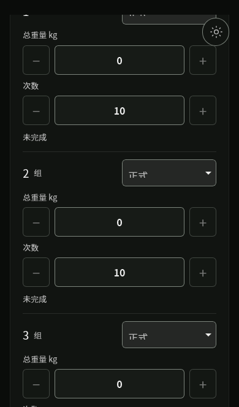
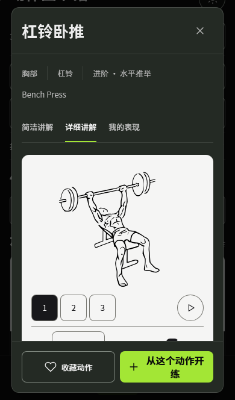
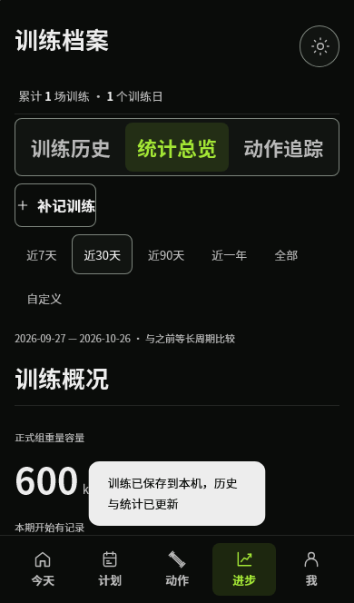
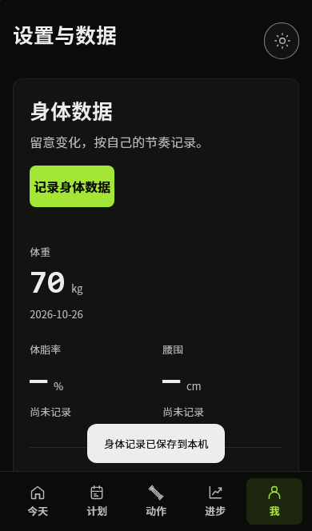

# 健力宝

一款本地优先的中文训练记录应用。记录每一组训练，查看动作讲解、历史统计和身体变化；支持手机主屏幕安装、离线使用及可选加密云同步。

**[直接使用网页版](https://jianlibao-training-raitox.netlify.app/) · [下载各版本](https://github.com/Raito666/jianlibao/releases) · [使用说明](docs/USAGE.md) · [开发与自托管](docs/DEVELOPMENT.md)**

当前应用版本 **0.4.0**，本次公开源码为 **2026-10-28** 快照。网页版、模拟器包和真机待签名包的日期不同，请按下面的表选择。

## 手机怎么安装

| 设备 | 推荐方式 |
| --- | --- |
| iPhone / iPad | Safari 打开[网页版](https://jianlibao-training-raitox.netlify.app/)，分享 → 添加到主屏幕。 |
| 安卓手机 | Chrome 打开网页版，菜单 → 安装应用 / 添加到主屏幕。 |
| Windows / Mac | 直接用浏览器；支持的浏览器可安装为独立应用窗口。 |

无需登录 ChatGPT，无需购买 Apple 开发者会员。微信内请先选择用系统浏览器打开。

## 可以做什么

- **训练记录**：模板或自由训练、重量/次数/时长、快速加减、上次成绩、热身/正式/递减/力竭组、RPE、休息计时、暂停与草稿恢复。
- **动作讲解**：302 个动作、中文简洁/详细讲解、三帧 SVG；按肌群、器械和名称查找，部分动作附有带署名的图片及轻量视频。
- **历史与统计**：训练日历、逐组明细、补记/修正/复练、容量与时长趋势、热图、个人最佳、动作追踪。
- **身体数据**：体重、体脂率、围度与备注，按日期查看趋势。
- **离线与备份**：本机自动保存、JSON 导入/导出、CSV 明细、离线图解和按需保存示范。
- **可选云同步**：由你保存密钥连接设备，同步已归档训练、动作、模板和身体数据；草稿与设备偏好留在本机。

## 程序截图

以下为已有隔离演示环境截图，使用合成数据，未展示用户私人记录。截图来自 2026-10-26 的手机尺寸浏览器；不是 iPhone 真机照片。最新备份文案不在这些截图内。

| 逐组记录 | 动作详细讲解 |
| :---: | :---: |
|  |  |

| 历史统计 | 身体数据 |
| :---: | :---: |
|  |  |

## 版本与下载

| 版本 | 用途 | 状态与下载 |
| --- | --- | --- |
| **Web / PWA · 2026-10-28** | 手机、电脑日常使用 | [最新版与完整静态资源包](https://github.com/Raito666/jianlibao/releases/tag/v0.4.0-web.20261028)；包含最新备份文案。 |
| **iOS Simulator · 2026-10-27** | Apple Silicon Mac 上的 iOS Simulator | [无签名模拟器 ZIP 与对应源码](https://github.com/Raito666/jianlibao/releases/tag/v0.4.0-ios-simulator.20261027)。历史包，首次系统启动超时，未完成原生运行验收。 |
| **iPhone 待签名 · 2026-10-23** | 有经验的开发者自行签名安装 | [未签名 IPA 与对应源码](https://github.com/Raito666/jianlibao/releases/tag/v0.4.0-ios-device.20261023)。历史开发包，未经真机安装验证。 |

**模拟器 ZIP 不能装到 iPhone。未签名 IPA 不能下载后直接安装，也不提供永久免签。** 当前没有独立 EXE、APK、App Store 或 TestFlight 版本。手机日常使用请选择 PWA。

详细安装步骤、版本差异和已知限制见[版本说明](docs/RELEASES.md)。下载页提供 SHA-256 清单以识别文件，不代表运行验收。

## 一分钟上手

1. 在“今天”或“计划”开始训练，按实际情况填写重量、次数或时长。
2. 每组完成后点完成；训练结束进入回顾，再点“保存训练”归档。
3. 在“动作”查看讲解，在“进步”查看历史、统计和动作追踪。
4. 在“我”记录身体数据、准备离线资源、导出 JSON 备份。

重量填写总外部负重；双哑铃填写两只合计。热身、跳过与未完成组不计入正式容量，次数和时长分别统计。

## 数据与隐私

训练数据默认保存在当前设备的当前站点空间。公开的是程序源码和开发构建包，**不包含个人训练数据、备份、同步密钥或开发令牌**。原有私有开发仓库没有改为公开。

- 换网址、浏览器、设备或主屏幕入口可能产生独立存储空间，用 JSON 或同一同步密钥迁移；不要清除旧入口数据。
- JSON 是完整业务备份；CSV 不是可恢复备份。普通 JSON 不含离线媒体和云同步密钥。
- 云同步为可选功能；密钥请单独保管。免费服务有额度限制，没有永久可用或无限容量承诺。
- 公开源码不会改变现有网址、用户本机数据、备份格式或历史快照。

## 开发启动

需要 Node.js 与 pnpm，建议使用 Node 24 或更新的兼容版本；构建时使用锁文件中的依赖。

```sh
pnpm install --frozen-lockfile
pnpm dev
```

打开终端显示的本地地址。生产构建使用 `pnpm build`，随后 `pnpm preview`；不要直接双击 `dist/index.html`。本地 Vite 服务没有云同步后端，自托管步骤见[开发说明](docs/DEVELOPMENT.md)。

React 19 · TypeScript · Vite · 原生 CSS · Web IndexedDB · iOS Capacitor / SQLite / Keychain。没有更换现有技术栈或数据格式。

## 许可与当前边界

程序按 **[AGPL-3.0-or-later](LICENSE)** 开源。动作媒体保留各自 CC BY-SA 3.0 / 4.0 等许可；不能把全部素材统一改标 AGPL。[完整第三方署名](src/content/ATTRIBUTION.md) · [SVG 署名](public/exercise-art/ATTRIBUTION.md) · [原生依赖声明](ios/THIRD-PARTY-NOTICES.md)。

此次为公开发布整理，没有重新运行应用测试或验收。最近一次备份文案已构建并发布；新的原生包因免费 M2 额度不足尚未生成，现有 iOS 包均保留真实构建日期。原生云同步、锁屏提醒、真机安装与重启数据保留仍需实际 iOS 验收。训练说明供参考，请按自己的能力选择动作和负重。
